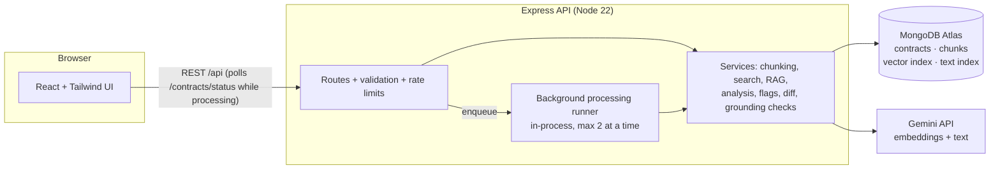
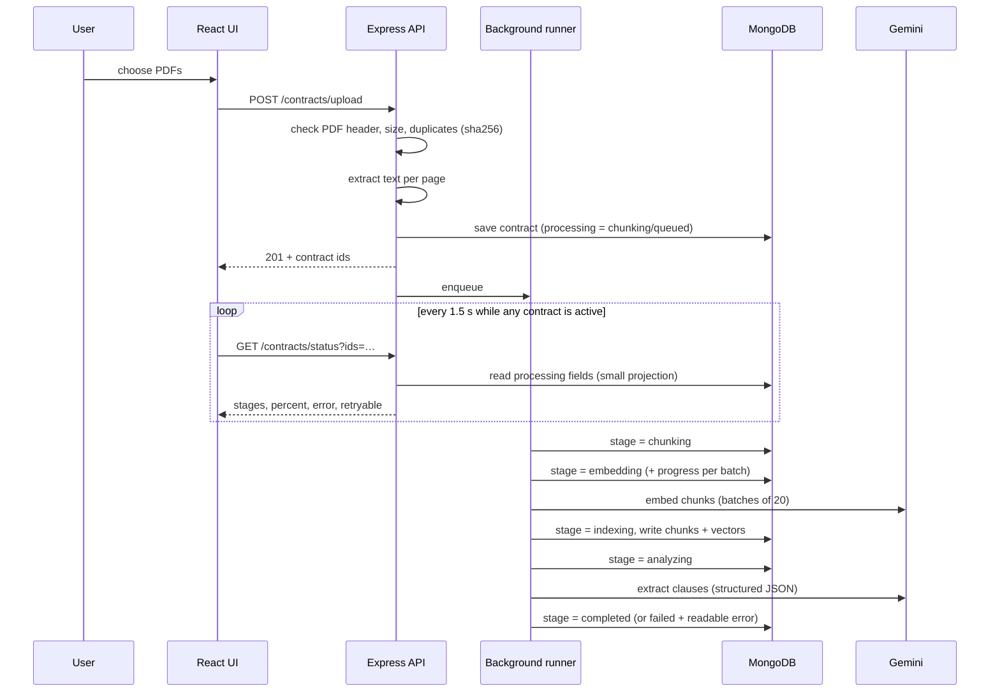
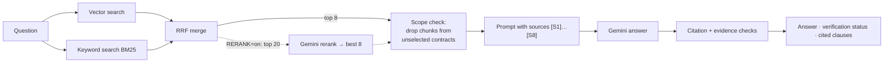

# ContractIQ

**AI-assisted contract intelligence.** Upload contract PDFs and ContractIQ splits them into clauses, indexes them for hybrid search, extracts key terms with evidence, answers questions with clickable citations, and compares vendors or versions side by side.

Every AI output points back to the contract text, and the app shows when that evidence could **not** be confirmed.

> ⚠️ **Disclaimer:** ContractIQ provides AI-assisted contract analysis for review purposes only. It is **not legal advice** and is not a substitute for a qualified lawyer. Always read the cited contract text before relying on any output.

---

## Table of contents

1. [Problem statement](#problem-statement)
2. [Key features](#key-features)
3. [Screenshots](#screenshots)
4. [Technology stack](#technology-stack)
5. [Architecture](#architecture)
6. [System workflow](#system-workflow)
7. [Contract processing pipeline](#contract-processing-pipeline)
8. [The RAG pipeline](#the-rag-pipeline)
9. [Hybrid retrieval explained](#hybrid-retrieval-explained)
10. [Citation and evidence checks](#citation-and-evidence-checks)
11. [API overview](#api-overview)
12. [Database models](#database-models)
13. [Environment variables](#environment-variables)
14. [Run it locally](#run-it-locally)
15. [Evaluation](#evaluation)
16. [Testing](#testing)
17. [Known limitations](#known-limitations)
18. [Future improvements](#future-improvements)

---

## Problem statement

Teams that buy software sign many vendor contracts. Answering simple questions such as *"How much notice do we need to cancel?"* or *"Which vendor has the lower liability cap?"* means reading dozens of pages per contract. Generic chatbots can answer quickly, but they can invent terms, mix up contracts, or cite text that does not exist, which is dangerous for contracts.

ContractIQ aims to make contract review **faster without becoming less trustworthy**:

- answers come only from retrieved contract clauses, with citations you can open;
- citations the model invents, or chunks from contracts you did not select, are removed;
- extracted clauses carry a quote that is checked against the real text;
- deterministic code (not AI) is used wherever it is enough: chunking, version diffs, flags.

## Key features

| Feature | What it does | Uses AI? |
|---|---|---|
| **Upload with live processing status** | Each PDF goes through upload → text extraction → chunking → embeddings → indexing → clause analysis. The UI shows every stage (✓ done, spinner for the current one, red error with a readable message), a progress bar, and a **Retry** button when retrying is safe. Status is stored in MongoDB, so a page refresh shows the same state. | Embeddings + analysis |
| **Clause-aware chunking** | Splits text at clause headings (`9. Limitation of Liability`), so each chunk is one clause with its section number and page numbers | No |
| **Hybrid search** | Vector search (meaning) + BM25 keyword search (exact words), merged with Reciprocal Rank Fusion | Embeddings |
| **Ask (RAG)** | Answers only from retrieved clauses with `[S1]` citations. Each citation opens the clause inside its contract. Invalid citations are removed and reported; uncited statements and numbers missing from the cited text are flagged; the model abstains when the contracts do not contain the answer | Yes |
| **Reranker** *(optional)* | Retrieves 20 candidates, Gemini re-scores them, the best 8 go to the answer step. Falls back to hybrid order if the call fails | Yes |
| **Contract analysis** | Extracts parties, dates and 11 clause types as structured JSON. Each clause is labelled **Verified** (its quote was found in the contract), **Unverified** (with the reason) or **Not in contract** | Yes |
| **Executive summary** | One-screen brief written from the analysis and flags | Yes |
| **Flags** | Rule-based notices: auto-renewal, long notice periods, liability cap, missing SLA… with configurable thresholds | No |
| **Version compare** | Text diff finds added / removed / changed clauses and changed values; Gemini only explains them | Explains only |
| **Vendor compare** | Pairs the same clause type across two contracts even when the wording differs | Yes |
| **Export** | PDF and CSV for a contract overview, comparisons and the flags table | No |
| **Evaluation** | `npm run eval` measures retrieval (recall@8, MRR) and answer quality over a 30-question dataset | Yes |

## Screenshots

> Screenshots are not included in the repository yet. Add your own to `docs/screenshots/` and update the paths below.

| Screen | Image |
|---|---|
| Upload + live processing tracker | `docs/screenshots/processing.png` *(placeholder)* |
| Contract overview with verified / unverified clauses | `docs/screenshots/analysis.png` *(placeholder)* |
| Ask page with citations and the verification banner | `docs/screenshots/ask.png` *(placeholder)* |
| Vendor comparison | `docs/screenshots/compare.png` *(placeholder)* |

## Technology stack

| Layer | Technology |
|---|---|
| Frontend | React 19, Vite, Tailwind CSS 4, React Router, Axios. `jsPDF` + `jspdf-autotable` for PDF export (loaded only on click) |
| Backend | Node.js 22, Express 5, Mongoose, Multer (in-memory uploads), `pdf-parse`, `diff`, `express-rate-limit` |
| Database | MongoDB Atlas: documents + **Atlas Vector Search** index + **Atlas Search** (BM25) index. The free M0 tier is enough |
| AI | Google Gemini via `@google/genai`: `gemini-embedding-2` (768-dim embeddings) and a configurable chat model (default `gemini-3.5-flash-lite`) with structured JSON output |
| Tests | Node's built-in test runner (`node --test`) for both server and client logic. No extra test libraries |
| Deploy | Render (one service serving API + built client), optionally Vercel for the client. See [DEPLOY.md](DEPLOY.md) |

## Architecture



## System workflow



## Contract processing pipeline

| # | Stage shown in the UI | What happens | Where |
|---|---|---|---|
| 1 | File uploaded | Multer receives the file in memory. The server checks the `%PDF-` header (not just the file name), the size (≤ 20 MB) and the count (≤ 10), and skips exact duplicates by SHA-256 hash | `middleware/upload.js`, `contractService.createContractFromPdf` |
| 2 | Extracting text from PDF | `pdf-parse` extracts text **per page** (so every chunk knows its pages). PDFs with fewer than 200 characters are rejected as probably scanned (no OCR) | `pdfService.js` |
| 3 | Splitting document into chunks | Clause-aware chunking: a new chunk starts at each clause heading (`9. …`, `Section 5:`, `ARTICLE IV`, all-caps titles). Long clauses are split at sub-clauses (`9.2`, `(a)`) up to ~2,400 characters, and the heading is repeated in every part | `chunkService.js` |
| 4 | Generating embeddings | Each chunk is embedded as `title: <contract> \| text: <clause>` with `gemini-embedding-2` (768 dimensions), 20 chunks per API call, with retries on 429/503. Progress is saved after each batch | `embeddingService.js` |
| 5 | Indexing document for search | Old chunks are replaced and the new ones (text + vector + section + pages) are written to MongoDB. Atlas Search and Atlas Vector Search index them automatically, near real time | `contractService.processContract` |
| 6 | Analyzing contract clauses | The whole contract (labelled `[C0]`, `[C1]`, …) is sent once to Gemini with a JSON schema for parties, dates and 11 clause types. Quotes are then verified against the text; rule-based flags are computed | `analysisService.js`, `flagService.js` |
| 7 | Processing completed | Contract is searchable, askable and comparable | |

**How status works.** Steps 1–2 run inside the upload request, so a bad file (not a PDF, scanned, duplicate) is rejected immediately. Steps 3–6 run in the background inside the same Node process (at most `PROCESSING_CONCURRENCY` contracts at a time). Every stage change is one small `$set` on `contract.processing`, so a page refresh just reads it back. The frontend polls one batch endpoint every 1.5 s **only while something is still running**, stops on completion, failure or unmount, and backs off if the server is unreachable.

**Failures and retry.** A failure records the stage and a readable message (for example *"Gemini rate limit or quota reached. Wait a minute and try again."*). Retry is offered only when it is safe: never while a run is queued or running (an atomic MongoDB update prevents two runs), and only when the extracted text exists. A failed analysis retries only the analysis; earlier failures redo chunking and embedding. If the server restarts mid-run, the contract is marked *interrupted* at startup and can be retried.

**Why no Redis, queue or WebSockets?** For a single-server app, polling a persisted status is simpler, survives page refreshes, and needs no new infrastructure. The trade-off is listed under [Known limitations](#known-limitations).

## The RAG pipeline

RAG (Retrieval-Augmented Generation) means: find the relevant text first, then let the model answer **only** from that text.



1. **Retrieve** – hybrid search returns the 8 best chunks. With several contracts selected, each contract is searched separately (at least 3 chunks each), so a long contract cannot crowd out the others.
2. **Scope check** – any chunk whose contract is not in the user's selection is dropped before the prompt is built, so it can never be cited.
3. **Augment** – the chunks become numbered sources with their contract, vendor, version, section and pages.
4. **Generate** – the system prompt tells the model to use only the sources, never invent terms, amounts, dates or obligations, cite after every factual sentence, not calculate new values, and reply exactly *"I could not find this in the selected contracts."* when the answer is not there.
5. **Verify** – see [Citation and evidence checks](#citation-and-evidence-checks). If nothing relevant is retrieved, the model is not called at all.

## Hybrid retrieval explained

| Step | What it is | Why it is here |
|---|---|---|
| **Vector search** | Atlas `$vectorSearch` over the 768-dim chunk embeddings, cosine similarity, pre-filtered by contract/vendor/version. Questions are embedded with a query prefix (`task: search result \| query: …`) and chunks with a document prefix (asymmetric retrieval) | Finds clauses by **meaning**: "cancel the deal" matches *Termination* |
| **BM25 keyword search** | Atlas `$search` with the `lucene.english` analyzer (lower-casing + stemming). Words in the clause **title** count double; `"quoted phrases"` must match exactly | Finds **exact tokens** embeddings miss: `ISO/IEC 27001`, `Schedule 1`, `EUR 120,000`, `72 hours` |
| **Reciprocal Rank Fusion** | Both lists (3× more candidates than needed, at least 20) are merged by rank, not score: `score = Σ 1 / (60 + rank)` | Vector scores (0–1) and BM25 scores (0–∞) are not comparable, but ranks are. A chunk ranked well in **both** lists wins |
| **Reranking** *(optional)* | `RERANK=on` (or the Ask page toggle): retrieve 20, Gemini scores each passage 0–10 against the question, keep the best 8 while guaranteeing each selected contract keeps its best 2 | A second, more careful look at question + passage together. Falls back to the hybrid order if the call fails |

The Search page lets you run each mode separately and shows why each chunk was found (`vector #2 · keyword #1 · rerank #1`).

## Citation and evidence checks

These checks are deterministic string checks (no second AI call). They show **where to look**; they do **not** prove an answer is correct. A cited sentence can still misread its source, so the UI always says "check the source", never "true".

**Q&A answers** get one of four statuses:

| Status | Meaning |
|---|---|
| `cited` | Every factual statement cites a source the model was actually given, and every number in it appears in that source |
| `partially_cited` | Some statements have no citation, a number does not appear in the cited text, or the model cited a source ID it was never given (removed and listed) |
| `uncited` | No valid citation at all. Shown as an unverified answer |
| `insufficient_information` | Nothing relevant was retrieved, or the model abstained |

Numbers are compared after normalising (`120,000` = `120000`) and spelled-out numbers in the contract count (`thirty (30) days`, `twelve months`). Each cited source has an **Open in contract →** link to the exact chunk.

**Contract analysis** clauses get:

| Label | Rule |
|---|---|
| ✓ **Verified** | The model's quote was found in the contract (case, spacing and curly quotes ignored; `…` in a shortened quote is allowed; a punctuation-only difference is accepted and noted). Very short quotes only count inside the chunks the model cited |
| ⚠ **Unverified** | The model said the clause exists, but the quote is missing or not in the text. The summary and the cited sections are **kept** so the user can check them, with the reason in `verificationNote`. Cited chunk IDs that do not exist are recorded in `invalidChunkIds` |
| **Not in contract** | The model reported no such clause |

Key values with numbers that do not appear in the cited text (e.g. *"24 months"* when the clause says *12 months*) are marked **⚠ not in cited text**.

## API overview

| Method | Route | Purpose |
|---|---|---|
| GET | `/api/health` | Health check |
| POST | `/api/contracts/upload` | Upload PDFs (`files`, optional `metadata` JSON). Returns `201` with per-file results; processing continues in the background |
| GET | `/api/contracts` | List contracts (no page text), each with its `processing` view |
| GET | `/api/contracts/status?ids=a,b` | **Processing status of up to 50 contracts in one call** (used for polling). Deleted ids are returned in `missing` |
| GET | `/api/contracts/:id` | Full contract (pages, analysis, flags, summary, `processing`) |
| GET | `/api/contracts/:id/status` | Processing status of one contract |
| GET | `/api/contracts/:id/chunks` | The clause chunks |
| POST | `/api/contracts/:id/retry` | Retry a failed run from the safest stage → `202`, or `409` if not retryable / already running |
| POST | `/api/contracts/:id/process` | Re-chunk, re-embed and re-analyse from scratch in the background → `202` |
| POST | `/api/contracts/:id/analyze` | Re-run clause analysis synchronously (`409` while processing) |
| POST | `/api/contracts/:id/summary` | Executive summary (needs the analysis) |
| DELETE | `/api/contracts/:id` | Delete a contract and its chunks (safe even mid-processing) |
| POST | `/api/search` | `{ query, mode?, contractIds?, vendor?, version?, limit?, groupByContract? }` |
| POST | `/api/ask` | `{ question, contractIds?, rerank? }` → `{ answer, citations, sources, abstained, verification, … }` |
| POST | `/api/compare/vendors` | `{ contractIdA, contractIdB }` |
| POST | `/api/compare/versions` | `{ oldId, newId, explain? }` |

Example `processing` view (returned by the status endpoints and the contract endpoints):

```json
{
  "stage": "embedding",
  "state": "running",
  "label": "Generating embeddings",
  "error": null,
  "progress": { "done": 20, "total": 41 },
  "percent": 37,
  "active": true,
  "retryable": false,
  "retryFrom": null,
  "stages": [
    { "key": "uploaded", "label": "File uploaded", "status": "done" },
    { "key": "parsing", "label": "Extracting text from PDF", "status": "done" },
    { "key": "chunking", "label": "Splitting document into chunks", "status": "done" },
    { "key": "embedding", "label": "Generating embeddings", "status": "active" },
    { "key": "indexing", "label": "Indexing document for search", "status": "pending" },
    { "key": "analyzing", "label": "Analyzing contract clauses", "status": "pending" },
    { "key": "completed", "label": "Processing completed", "status": "pending" }
  ]
}
```

Errors are always JSON: `{ "error": "readable message" }`. Gemini problems map to useful statuses: `429` for rate limit / quota, `503` when the key is missing or Gemini is unavailable, `502` for a rejected key or unknown model. Rate limits per IP: 20 AI requests/min, 60 searches/min, 10 uploads per 10 min.

## Database models

| Model | Responsibility | Key fields |
|---|---|---|
| **Contract** (`models/Contract.js`) | One uploaded PDF and everything derived from it | `title`, `vendor`, `version`, `fileHash` (duplicate check), `pages[]` (text per page), `status` (what data exists: `parsed → chunked → embedded → analyzed`), `processing` (live pipeline stage, state, progress, error, attempts, timestamps), `analysis` (parties, dates, clauses with verification), `flags[]`, `executiveSummary` |
| **Chunk** (`models/Chunk.js`) | One clause (or part of a long clause): the unit that is embedded, searched and cited | `contractId`, `vendor`, `version` (copied for search filters), `chunkIndex`, `text`, `sectionNumber`, `sectionTitle`, `pageStart`, `pageEnd`, `embedding` (768 numbers) |

`status` and `processing` are separate on purpose: search only uses contracts whose `status` is `embedded` or `analyzed`, while `processing` describes what the background runner is doing right now.

Atlas indexes on `chunks` (created by `npm run create:index`): `chunk_vector_index` (vector, cosine, filters on contractId/vendor/version) and `chunk_text_index` (BM25 on text and sectionTitle).

## Environment variables

Copy `server/.env.example` to `server/.env` and fill in your own values. Never commit `.env`.

| Variable | Required | Default | Purpose |
|---|---|---|---|
| `MONGODB_URI` | yes | – | MongoDB Atlas connection string (include the database name, e.g. `/contractiq`) |
| `GEMINI_API_KEY` | yes (for AI features) | – | Google AI Studio key. Upload and text extraction work without it; processing then fails at "Generating embeddings" with a clear message |
| `PORT` | no | `5000` | API port |
| `CLIENT_URL` | no | `http://localhost:5173` | Allowed CORS origins (comma-separated). Not needed when Express serves the built client |
| `EMBEDDING_MODEL` | no | `gemini-embedding-2` | Changing it means recreating the vector index and re-processing contracts |
| `EMBEDDING_DIMENSIONS` | no | `768` | Same as above |
| `CHAT_MODEL` | no | `gemini-3.5-flash-lite` | Model for answers, analysis, summaries, comparisons |
| `RERANK` | no | `off` | `on` = rerank retrieved chunks before answering (one extra Gemini call per question) |
| `AUTO_ANALYZE` | no | `on` | `off` = processing stops after indexing; analysis can still be run from the contract page |
| `PROCESSING_CONCURRENCY` | no | `2` | Contracts processed in the background at the same time (1–4) |

Client (`client/.env`, optional): `VITE_API_URL`, leave empty locally (Vite proxies `/api` to `localhost:5000`); set it only when the API is on another host.

## Run it locally

Prerequisites: Node.js 22+, a MongoDB Atlas cluster (free M0 works), a Gemini API key.

```bash
# 1. install
npm install --prefix server && npm install --prefix client

# 2. configure
cp server/.env.example server/.env      # then set MONGODB_URI and GEMINI_API_KEY

# 3. create the Atlas vector + text indexes (once)
npm run create:index --prefix server

# 4. start (two terminals)
npm run dev --prefix server             # API on http://localhost:5000
npm run dev --prefix client             # UI on  http://localhost:5173
```

Then upload the PDFs in `samples/` (five example contracts; keep their file names, which become the titles used by the evaluation) and watch them move through the stages.

Production build: `npm run build --prefix client`, then `npm start --prefix server` serves the API and the built UI from one port.

## Evaluation

```bash
npm run eval --prefix server                 # retrieval + answers
npm run eval --prefix server -- --retrieval  # retrieval only (cheaper, no answer generation)
npm run eval --prefix server -- --rerank     # also measure hybrid+rerank
```

**Dataset.** `server/eval/dataset.json` has 30 questions over the 5 sample contracts: paraphrased and exact-keyword questions, multi-contract comparisons, and 4 questions the contracts cannot answer (the model should abstain). Questions about samples you have not uploaded are skipped. `npm test` also validates the dataset offline against the sample PDFs (every expected section exists and every answer phrase can be found in it).

**Metrics.**

- **recall@8** – share of expected clauses that appear in the top 8 retrieved chunks
- **MRR** – mean of 1 / rank of the first correct chunk (1.0 = always first)
- **fact accuracy** – the answer contains every required fact
- **citation accuracy** – the answer cites at least one expected section
- **abstention accuracy** – unanswerable questions get "not found" and no citations

Each run prints a ready-to-paste Markdown table and saves a dated JSON file in `server/eval/results/` (git-ignored).

**Results.** No evaluation results are committed to this repository yet, because the evaluation needs a live MongoDB Atlas cluster and Gemini API key. Run `npm run eval` and paste the printed table here:

| Retrieval | recall@8 | MRR |
|---|---|---|
| vector | *not yet run* | |
| keyword | | |
| hybrid | | |
| hybrid+rerank | | |

## Testing

```bash
npm test --prefix server   # 81 tests: chunking, retrieval/RRF, rerank, flags, diff, summary input, dataset,
                           # processing status + pipeline, status/retry/upload endpoints,
                           # citation checks, quote verification, Gemini error mapping
npm test --prefix client   # 9 tests: polling, notifications, upload validation, verification labels
```

The tests need **no database and no API key**: MongoDB model calls and the Gemini steps are replaced with fakes where needed, and the HTTP tests run the real Express app on a random port. One pipeline test runs the real chunking and embedding code on a sample PDF without a key to check that a genuine embedding failure is reported at the right stage.

## Known limitations

- **No authentication.** Anyone with the URL can upload, read and delete contracts. Add auth before using real contracts.
- **Background jobs run in the web process.** This assumes a single server instance. A restart interrupts running jobs (they become *failed – interrupted* with a Retry button); with several instances you would need a real job queue.
- **Status is polled**, not pushed, every 1.5 s while something is processing.
- **Indexing is eventually consistent.** Atlas indexes new chunks automatically within seconds; a search in the first moment after "completed" can still miss them.
- **No OCR.** PDFs must have selectable text. Numbered English-style clause headings chunk best.
- **Analysis is one large request** (up to ~300,000 characters of contract text). Longer contracts fail at the analysis stage with a clear message.
- **Evidence checks are heuristics.** They catch invented citations, uncited statements and numbers missing from the cited text, but cannot judge whether a sentence correctly interprets its source.
- **Uploads are held in memory** during the request (up to 10 × 20 MB).
- **PDF export** supports Western European characters only.
- Output is informational and **not legal advice**.

## Future improvements

- Authentication and per-user / per-organisation contracts.
- A durable job queue for multi-instance deployments, and server-sent events instead of polling.
- OCR for scanned PDFs.
- Chunked (map-reduce) analysis for very long contracts.
- An optional second-pass "entailment" check for high-stakes answers, measured with the evaluation set before turning it on.
- Committed evaluation results tracked over time (CI job against a test cluster).
- Browser end-to-end tests (e.g. Playwright) for the upload → processing → ask flow.

## Project layout

```
client/src/
  pages/        Contracts, ContractDetail, Search, Ask, Compare, Flags
  components/   ProcessingTracker, UploadForm, AnswerView, AnalysisView, Toasts, …
  services/     api.js, useProcessingStatus.js, processingView.js, verificationView.js, export*
client/test/    frontend logic tests (node --test)
server/
  services/     processingStatus · processingService · contract · pdf · chunk · embedding
                search · vectorSearch · keywordSearch · rerank · rag · grounding
                analysis · flag · summary · clauseDiff · comparison · gemini
  controllers/ routes/ middleware/ (rate limits, upload) models/ config/
  eval/         dataset.json + evaluate.js
  test/         unit + HTTP tests
  scripts/      CLIs (create indexes, eval, recompute flags, debug helpers)
samples/        5 example contracts
```

## Deploy

See [DEPLOY.md](DEPLOY.md) (Render blueprint in `render.yaml`).
